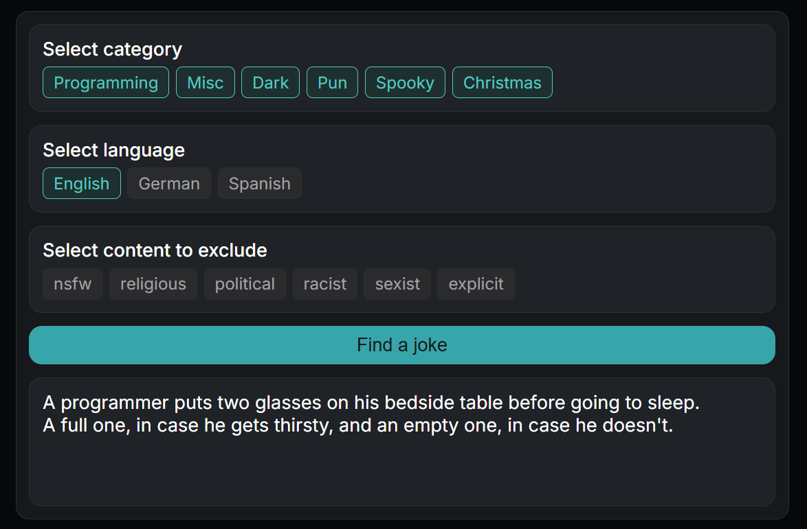

# Joke App

A small web app that fetches random jokes from [JokeAPI](https://jokeapi.dev). Choose the categories and language, exclude content you don't want to see, and press the button for a new joke. Your selections stay in place, so you can keep clicking for more.

## Features

- Filter by category (Programming, Misc, Dark, Pun, Spooky, Christmas)
- Choose a language (English, German, Spanish)
- Blacklist content flags (nsfw, religious, political, racist, sexist, explicit)
- Supports single and two-part jokes
- Shows a message when no joke matches the filters

## Built with

Node.js, Express, EJS, Axios, HTML and CSS

## Getting started

1. Clone the repository
2. Install the dependencies: `npm install`
3. Start the server: `node app.js`
4. Open `http://localhost:3000` in your browser
